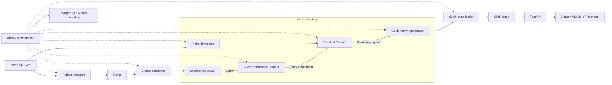
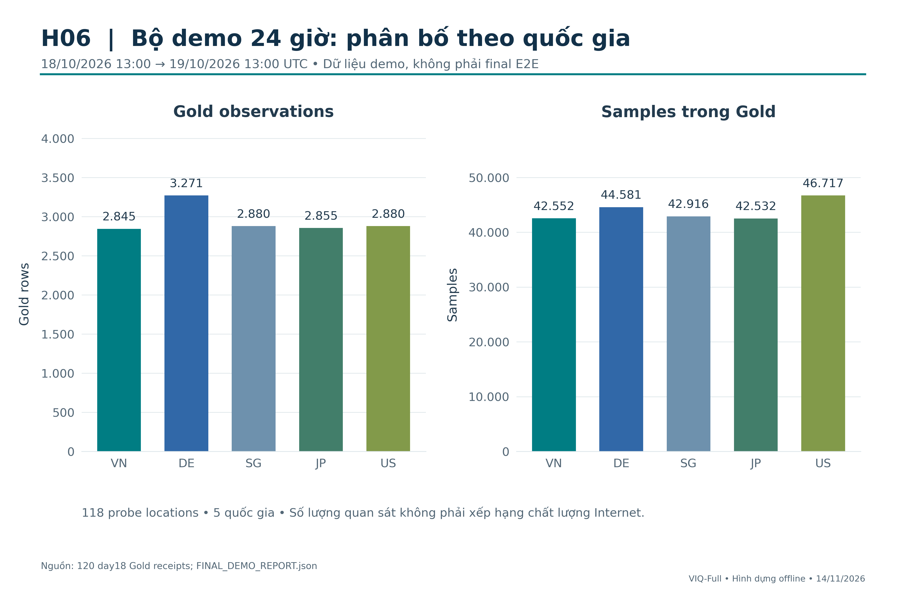
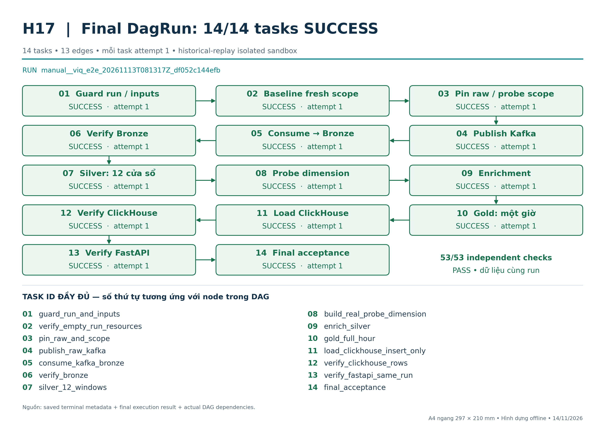

# VIQ-Full — Vietnam Internet Quality Monitoring

An end-to-end data pipeline for collecting, processing, and exploring RIPE Atlas Internet quality measurements.

## Overview

VIQ-Full là dự án thực tập Data Engineering về chất lượng kết nối Internet.
Dữ liệu đến từ RIPE Atlas: mạng lưới probes thực hiện các phép đo mạng từ nhiều vị trí.
Dự án chuyển kết quả Ping thành dữ liệu có cấu trúc để phân tích RTT, packet loss và biến động theo thời gian, quốc gia, probe và đích đo.

Pipeline kết hợp message transport, object storage, xử lý Spark, orchestration và analytical serving.
Dashboard giúp xem xu hướng; BigData Probe Explorer giúp khám phá các vị trí probe trên bản đồ.
Các chỉ số phản ánh tập phép đo đã chọn, không đại diện cho toàn bộ người dùng Internet của một quốc gia.

**Kết quả đã nghiệm thu:** một historical-replay E2E trong sandbox, từ Kafka đến FastAPI, với 14/14 Airflow tasks SUCCESS và 53/53 independent checks PASS.
Phạm vi này chưa bao gồm nghiệm thu frontend trên cùng run hoặc vận hành production realtime.
Xem [public E2E summary](docs/e2e/VIQ_E2E_FRESH_RECOVERY_FINAL_REPORT.md).

## Key Features

| Chức năng có trong source | Trạng thái kiểm chứng |
|---|---|
| Thu thập RIPE Atlas, publish/consume Kafka, DLQ | Historical replay E2E: 12 messages, DLQ 0 |
| MinIO Bronze/Silver/Enriched/Gold; Spark cleaning và aggregation | Đã kiểm tra counts, schema, hashes và lineage trong final run |
| Probe dimension và metadata enrichment | Final run: 24 probes, 375/375 records matched |
| Airflow orchestration, ClickHouse analytics, FastAPI serving | Đã nghiệm thu trên cùng final run |
| React Dashboard, MapLibre Probe Explorer, Recharts | Có implementation và dữ liệu demo; chưa có frontend acceptance trên final run |
| Country health, anomaly và incident analysis | Có code/DAG/API; không mặc định coi mọi nhánh đã được final E2E bao phủ |

## System Architecture



Mũi tên nét đứt biểu diễn orchestration. PostgreSQL lưu metadata điều phối; dữ liệu phân tích được phục vụ từ ClickHouse.
Spark là compute engine; các lớp Bronze/Silver/Enriched/Gold được lưu trong MinIO.

| Technology | Role |
|---|---|
| Python, RIPE Atlas REST API | Thu thập measurements và probe metadata |
| Apache Kafka | Tách producer/consumer, vận chuyển batches và theo dõi offsets/DLQ |
| MinIO | Lưu raw objects, Parquet và lineage artifacts qua giao thức S3 |
| Apache Spark / PySpark | Chuẩn hóa, validation, enrichment và hourly aggregation |
| Apache Airflow + PostgreSQL | Lập lịch, phụ thuộc task, trạng thái thực thi và metadata |
| ClickHouse | Truy vấn analytical data sau khi load Gold |
| FastAPI | HTTP endpoints cho measurements, quality, incidents và probe map |
| React / Vite, MapLibre, Recharts | Giao diện tương tác, bản đồ và biểu đồ |
| Docker / Docker Compose | Định nghĩa môi trường và các service; cần cấu hình/data riêng |

## Dataset

Một `measurement_id` nhận diện phép đo; `prb_id` nhận diện probe thực hiện phép đo đó.
Kết quả Ping chứa timestamp Unix, số gói gửi/nhận, RTT tổng hợp và có thể có RTT từng gói.
Probe metadata bổ sung quốc gia, ASN, trạng thái và tọa độ khi nguồn cung cấp.
RTT tính bằng milliseconds; packet loss được suy ra từ số gói gửi/nhận khi hợp lệ.

Ví dụ rút gọn từ [sample JSON](data/samples/ripe_atlas_ping_sample.json), giữ nguyên tên trường và giá trị trong sample; đây không phải input của final E2E:

```json
{
  "records": [
    {
      "msm_id": 1009,
      "prb_id": 1,
      "timestamp": 1789171200,
      "avg": 18.2,
      "sent": 3,
      "rcvd": 3,
      "result": [{"rtt": 17.4}, {"rtt": 18.1}, {"rtt": 19.1}]
    }
  ]
}
```

### Ba phạm vi dữ liệu độc lập

| Phạm vi | Cửa sổ dữ liệu UTC | Quy mô / kết quả |
|---|---|---|
| Historical corpus 48 giờ | 17/10/2026 13:00 → 19/10/2026 13:00 | 5 quốc gia, 439.170 Silver rows, 29.479 Gold rows |
| Historical demo 24 giờ | 18/10/2026 13:00 → 19/10/2026 13:00 | VN, DE, SG, JP, US; 118 vị trí probe, 219.298 raw samples, 14.731 Gold observations |
| Final isolated historical E2E | 18/10/2026 13:00 → 14:00; thực thi 13/11/2026 | DE, measurement 177401244; 375 records, 24 probes, 24 Gold rows |

Không cộng gộp ba phạm vi hoặc coi chúng là kết quả của một lần chạy.
118 là số vị trí có tọa độ trong demo, không phải tổng số probes của RIPE Atlas.
Corpus được đối chiếu từ receipts/Parquet; điều đó không chứng minh ingestion realtime liên tục.
Các thống kê demo không chứng minh một instance ClickHouse hiện tại đang chứa đúng cùng row versions.
Chi tiết: [báo cáo kỹ thuật](docs/reports/VIQ_FULL_MENTOR_TECHNICAL_REPORT.md) và [evidence map](docs/report/VIQ_REPORT_EVIDENCE_MAP.md).

## Data Processing Pipeline

| Bước | Xử lý và điều kiện cần giữ |
|---|---|
| Bronze | Lưu raw gần với nguồn; giữ measurement/window, ingestion metadata và Kafka lineage |
| Silver | Chuẩn hóa schema, UTC timestamp, RTT/loss; kiểm tra dữ liệu hợp lệ và read-back Parquet |
| Enrichment | Left join với probe dimension theo logic country/probe; theo dõi unmatched, không tự giả metadata |
| Gold | Aggregate theo giờ, quốc gia, measurement, probe và target; giữ counts để đối chiếu |
| Analytics | Load Gold sang ClickHouse; FastAPI truy vấn để phục vụ Dashboard/Explorer |

Gold hourly dùng khóa `hour_start_utc`, `country_code`, `measurement_id`, `probe_id`, `target`.
Các metrics gồm `sample_count`, số mẫu RTT/loss hợp lệ, RTT trung bình, median, p95 và packet loss trung bình.
Các thống kê RTT ở đây tổng hợp RTT của từng kết quả đo, không phải percentile của toàn bộ gói Ping gốc.
RTT có thể null khi mất gói hoàn toàn; không biến missing RTT thành 0.
Historical dimension là snapshot, chưa chứng minh metadata đúng tại mọi thời điểm lịch sử.

Trong final E2E: **375 raw records → 375 valid Silver → 375 matched Enriched → 24 Gold rows; tổng `sample_count` = 375**.
Số hàng giảm vì aggregation, trong khi số samples được bảo toàn.
12 Kafka messages chứa các batches của dữ liệu này; message count không đồng nghĩa record count.
Tỷ lệ matched 100% thuộc final run đã chọn; corpus lịch sử vẫn có unmatched records.

## Project Structure

```text
.
├── api/                 # FastAPI và demo BigData endpoints
├── config/              # Monitoring configuration
├── configs/             # Runtime settings và configuration helpers
├── frontend/            # React Dashboard và bigdata-map.html
├── infra/
│   ├── airflow/         # DAGs, Dockerfiles và Compose
│   ├── clickhouse/      # Schema/bootstrap SQL
│   └── kafka/           # Kafka và Bronze consumer Compose
├── ingestion/           # RIPE Atlas extraction
├── messaging/           # Kafka transport
├── processing/          # Silver, Gold và isolated E2E logic
├── scripts/             # CLI entrypoints, loading và verification
├── storage/             # Storage integration
├── tests/               # Unit/integration tests và fixtures
├── data/samples/        # Small example input
└── docs/                # Reports, runbooks và figures
```

## Installation and Setup

### Prerequisites và mức độ tái lập

- Python 3.10 là baseline trong Dockerfiles; Spark 3.5.3 dùng Java 17 và Scala 2.12.
- Node.js `^20.19.0 || >=22.12.0` theo Vite 8.3.0 trong dependency metadata; dùng npm lockfile của frontend.
- Docker Engine chạy Linux containers và Docker Compose cho các service hạ tầng.
- Có quyền truy cập RIPE Atlas/MinIO/ClickHouse cùng credentials phù hợp; internet cho dependencies và map tiles.
- Historical inputs ở vùng dữ liệu ngoài repository, Docker volumes, images/networks và secrets không được đóng gói đầy đủ trong repository.

Sau khi lấy source, chạy lệnh từ repository root trừ khi có chỉ dẫn `cd frontend`.
`docker compose up` đơn lẻ chưa được chứng minh có thể tái tạo đầy đủ dataset và demo.
Các hướng dẫn dưới đây được đối chiếu tĩnh với source/config; không phải một lần triển khai mới đã chạy thử.

### Môi trường Python và cấu hình

Ví dụ PowerShell trong workspace mới:

```powershell
python -m venv .venv
.\.venv\Scripts\Activate.ps1
python -m pip install -r requirements-dev.txt -r requirements-api.txt
if (!(Test-Path .env)) { Copy-Item .env.example .env }
```

Trên Linux/macOS, kích hoạt bằng `source .venv/bin/activate`; chuẩn bị `.env` từ `.env.example` nếu chưa tồn tại.
Điền cấu hình cục bộ qua [environment template](.env.example), không commit credentials.
Các trường secret để trống có chủ đích; owner phải tự tạo. Xem [deployment guide](docs/DEPLOYMENT.md) về Airflow DSN, JWT và networking.

| Nhóm | Tên environment variables |
|---|---|
| RIPE Atlas | `RIPE_ATLAS_BASE_URL`, `RIPE_DEFAULT_MEASUREMENT_ID`, `RIPE_REQUEST_TIMEOUT`, `RIPE_MAX_RETRIES`, `RIPE_BACKOFF_SECONDS` |
| MinIO | `MINIO_ENDPOINT`, `MINIO_INTERNAL_ENDPOINT`, `MINIO_ACCESS_KEY`, `MINIO_SECRET_KEY`, `MINIO_BUCKET` |
| Kafka / Spark / logging | `KAFKA_BOOTSTRAP_SERVERS`, `SPARK_MASTER`, `LOG_LEVEL` |
| ClickHouse | `CLICKHOUSE_HOST`, `CLICKHOUSE_HTTP_PORT`, `CLICKHOUSE_NATIVE_PORT`, `CLICKHOUSE_DATABASE`, `CLICKHOUSE_USER`, `CLICKHOUSE_PASSWORD` |
| Airflow | `AIRFLOW_POSTGRES_PASSWORD`, `AIRFLOW_DATABASE_URL`, `AIRFLOW_JWT_SECRET` |
| Frontend | `VITE_API_BASE_URL` |

Host và container có endpoint khác nhau; không dùng `localhost` của container để chỉ một service khác.
Dependencies host không bao phủ mọi nhánh registry/E2E: có nhánh cần `psycopg` riêng; E2E verifier cần PyArrow.
Các nhánh signed-registry/Parquet verifier có [optional requirements](requirements-optional.txt).
Isolated image có [requirements riêng](requirements-e2e.txt), Airflow constraints, Java và S3 JARs; không cài chồng bộ đó vào môi trường host một cách mặc định.

### 1. API / frontend với dữ liệu demo đã nạp

Cần ClickHouse local sandbox đã có schema và dữ liệu tương thích.
BigData endpoint chỉ chấp nhận host loopback, HTTP port 18123 và database `viq_demo_24h` hoặc `telecom_g1`.
Cấu hình các biến ClickHouse cùng quyền đọc trước khi chạy; README không cung cấp hoặc tự tạo credentials/dataset.

```powershell
python -m uvicorn api.demo_bigdata:app --host 127.0.0.1 --port 8000
```

Entrypoint này mở rộng `api.main:app`, thêm `/bigdata/probes`; API thông thường dùng `api.main:app`.
Kiểm tra `/health` và `/docs` trên port 8000 để xem contract thực tế.
Trong terminal thứ hai:

```powershell
cd frontend
npm ci
npm run dev
```

Mở URL Vite in ra, mặc định port 5173: `/` cho Dashboard và `/bigdata-map.html` cho Explorer.
React dùng `VITE_API_BASE_URL`, mặc định `http://127.0.0.1:8000`; Explorer HTML hiện cố định API tại địa chỉ đó.
CORS của API cho phép localhost/127.0.0.1 trên port 5173.
`npm run build` và `npm run preview` có trong package scripts; cấu hình build hiện chưa đưa Explorer HTML vào `dist` như một entrypoint riêng.

### 2. Các thành phần data pipeline

| Cấu hình / entrypoint | Vai trò và lưu ý |
|---|---|
| [Root Compose](docker-compose.yml) | MinIO 9000/9001, ClickHouse HTTP 8123, API 8000; Spark nằm trong profile `tools` |
| [Kafka Compose](infra/kafka/docker-compose.yml) | Kafka 3.9.1: host 9092, Docker-host 29092, nội bộ 39092; service `bronze-consumer` riêng |
| [Airflow Compose](infra/airflow/docker-compose.yml) | Airflow 3.3.2 standalone/LocalExecutor, PostgreSQL 16 metadata, UI 8080 |
| `scripts/publish_ripe_country_kafka.py` | Publish measurements theo country scope |
| `scripts/consume_ripe_kafka_to_bronze.py` | Consume Kafka và lưu Bronze |
| `scripts/run_silver.py` | Silver chuẩn hóa, bắt buộc `--start` và `--stop` |
| `scripts/run_probe_country_dimension.py`, `scripts/run_silver_country.py` | Probe dimension và country-scoped enrichment |
| `scripts/run_gold_hourly.py`, `scripts/load_clickhouse.py` | Hourly Gold / ClickHouse load, có `--country-code`, `--start`, `--stop` |

Kiểm tra cấu trúc Compose mà không cần credentials hoặc start service:

```powershell
docker compose --env-file .env.example config --no-interpolate --no-env-resolution --quiet
docker compose --env-file .env.example -f infra/kafka/docker-compose.yml config --no-interpolate --no-env-resolution --quiet
docker compose --env-file .env.example -f infra/airflow/docker-compose.yml config --no-interpolate --no-env-resolution --quiet
```

Chỉ trong lab mới đã chuẩn bị cấu hình, credentials, storage và namespace riêng:

```powershell
docker compose up -d minio clickhouse
docker compose --env-file .env -f infra/kafka/docker-compose.yml up -d kafka
```

Bản public dùng project `viq-public` và volume MinIO mới do Compose quản lý; không tham chiếu volume dữ liệu gốc.
Bucket/init và quyền truy cập phải được chuẩn bị riêng.
Các lệnh trên chưa chạy consumer, Spark, Airflow hoặc load dữ liệu.
Không khởi động lại Airflow metadata cũ hay dùng các recovery scripts chỉ để xem demo.
Spark cần đúng Java/S3 JARs từ `Dockerfile.spark`; command Spark mặc định trong Compose chưa truyền `--start`/`--stop` bắt buộc.
Chọn country/window/output scope mới, kiểm tra input và destination trước khi chạy CLI/DAG; không dùng lại historical paths để thử lệnh.

### 3. Isolated historical E2E

Đọc [E2E runbook](docs/e2e/VIQ_E2E_RUNBOOK.md), [MinIO operator setup](docs/e2e/VIQ_E2E_MINIO_OPERATOR_SETUP.md) và [isolated Compose](infra/airflow/docker-compose.viq-e2e-isolated.yml).
Luồng này cần pinned inputs, manifest, image/dependencies, external networks, resources, secrets và owner authorization riêng.
Các run/resume identities của final report đã **CONSUMED**: không copy lệnh trigger hoặc dùng lại identity trong runbook lịch sử.
Một lần tái lập mới cần namespace, manifest và approval mới; README không cung cấp lệnh kích hoạt E2E cũ.

## Results and Validation

Kết quả dưới đây chỉ thuộc final historical-replay E2E thực thi ngày 13/11/2026:

| Component | Verified Result |
|---|---|
| Kafka | 12 messages, DLQ 0 |
| Bronze | 375 records |
| Silver | 375 valid records, 0 invalid |
| Probe dimension / enrichment | 24 probes; 375 matched records |
| Gold | 24 rows / tổng 375 samples |
| ClickHouse | 24 rows |
| FastAPI | Same-run verification PASS |
| Airflow | 1 actual DagRun; 14/14 tasks SUCCESS |
| Independent checks | 53/53 PASS |
| Official Scoped Stop | PASS |

[Public summary](docs/e2e/VIQ_E2E_FRESH_RECOVERY_FINAL_REPORT.md) ghi nguồn gốc báo cáo, task states và acceptance boundaries.
Raw runtime evidence và approval lịch sử không nằm trong bản public; các thay đổi export chưa được nghiệm thu lại bằng E2E.
Kết quả này không đưa ra benchmark throughput, production SLA, high availability hoặc frontend same-run acceptance.

## Dashboard Screenshots và hình minh họa

Chưa có screenshot Dashboard overview, Explorer world map hoặc probe popup phù hợp để nhúng từ repo hiện tại.
Hai hình dưới là **hình báo cáo có sẵn**, không phải screenshot giao diện hoặc Airflow UI; tổng dung lượng khoảng 0,8 MiB.



*Demo 24 giờ: phân bố dữ liệu của năm quốc gia; tách biệt với final E2E.*



*Hình tổng hợp offline từ evidence của final run; không phải ảnh chụp Airflow UI.*

## Limitations & Future Improvements

- Final E2E là historical sandbox replay đến FastAPI; chưa chứng minh ingestion realtime production hoặc frontend cùng run.
- Chưa có benchmark quy mô lớn, distributed Spark cluster, SLA hay high availability acceptance.
- Dữ liệu lịch sử, Docker resources, credentials và một số runtime dependencies vẫn nằm ngoài repo.
- Probe coverage, missing coordinates và snapshot metadata giới hạn cách diễn giải chất lượng theo địa lý.
- Ưu tiên tiếp theo: chuẩn hóa config/data dependencies, reproducible deployment, monitoring/alerting, benchmark và frontend acceptance.

## References

- [RIPE Atlas REST API](https://atlas.ripe.net/docs/apis/rest-api-reference/)
- [Apache Kafka 3.9 documentation](https://kafka.apache.org/39/)
- [Apache Spark documentation](https://spark.apache.org/docs/) — runtime của project được pin ở 3.5.3.
- [Apache Airflow documentation](https://airflow.apache.org/docs/)
- [MinIO documentation](https://docs.min.io/)
- [ClickHouse documentation](https://clickhouse.com/docs)
- [FastAPI documentation](https://fastapi.tiangolo.com/)
- [Báo cáo kỹ thuật VIQ-Full](docs/reports/VIQ_FULL_MENTOR_TECHNICAL_REPORT.md), [Figure index](docs/report/figures/FIGURES_INDEX.md)
